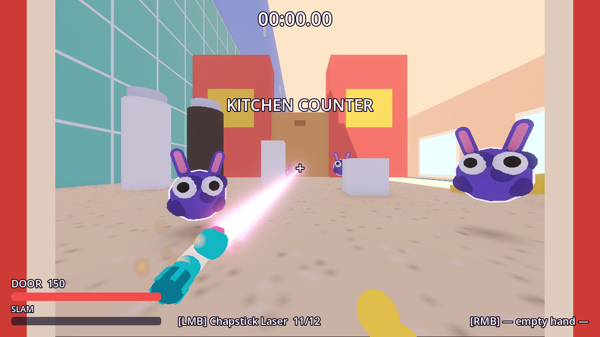

# Crumb Lords

**You are a door. You have a chapstick laser. The dust bunnies must die.**

A goofy, fast first-person shooter where you play as a dollhouse-sized household object loose in a giant kitchen. Blast your way down the kitchen counter, pick up a second weapon, beat the boss and race the clock.



## The game

- **Your object is your class.** Each has its own stats, a movement trick, one passive and one super. The **Door** is playable now:
  - **Hinge Hop** (movement trick): a double jump that lunges you forward.
  - **Solid Core** (passive): take 30% less damage from the front.
  - **Slam** (super): swing open as a shield wall, then slam shut and launch everything in front of you.
  - **Table** and **TV** are designed but not built yet.
- **Dual-wield household weapons** that float in a magical mist. Left mouse fires the left hand, right mouse fires the right.
  - **Chapstick Laser**: the stick shrinks back into the tube as you fire. Reloading twists the base to wind it back up.
  - **Stapler**: rapid fire. The arm chomps with every shot and flips open to reload.
- **Linear rooms, a boss, and a timer.** The run timer starts when you first move and stops when the boss dies. You get a medal (gold, silver or bronze) and your personal best is saved.
- **Checkpoint rules:** dying before you pick up the second weapon instantly restarts the level. After the pickup, you respawn there, but the clock keeps running.

### Level 1: Kitchen Counter
Two rooms of dust bunnies, the stapler pickup (which is also the checkpoint) and **the Dust Bunny King**, a crowned boss that body-slams the counter. Jump to dodge the shockwave. The front edge of the counter is a long drop, for you and for anything you knock off it.

## Controls

| Action | Key |
|---|---|
| Move | WASD |
| Jump / Hinge Hop (press again in the air) | Space |
| Fire left / right weapon | Left / Right mouse |
| Reload | R |
| Super (when the meter is full) | Q |
| Restart level | Backspace |
| Release mouse | Esc (click to recapture) |

## Running it

Requires **[Godot 4.7](https://godotengine.org/download)** (built and tested on 4.7.2, Forward+ renderer).

```sh
git clone git@github.com:zelder-bit/Crumb-Lords.git
cd Crumb-Lords
godot --path .            # play
godot -e --path .         # open in the editor
```

## Development

The game is built almost entirely in code: the scenes are tiny, and the level, player, weapons and enemies construct their nodes from primitive meshes at runtime. Everything is a rigid object, so animation uses tweens and procedural springs rather than skeletal rigs.

```
autoload/   GameState (timer, checkpoints, medals, input map), Sfx
classes/    PlayerClass base + DoorClass
player/     First-person controller, viewmodel render pass
weapons/    Weapon base, AmmoClip (pure logic), ChapstickLaser, Stapler, Fx
enemies/    Enemy base, DustBunny, DustBunnyKing
levels/     kitchen_counter.gd (builds the whole level)
ui/         HUD and results screen
debug/      Screenshot autoload for automated captures
tools/      gen_sfx.py (procedural sounds), shot.sh, review_shot.sh
test/unit/  GUT unit tests
docs/       DESIGN.md, ARCHITECTURE.md
```

**Checks:**

```sh
godot --headless --import                                                    # after adding scripts/assets
godot --headless --quit-after 300                                            # smoke run, should print no SCRIPT ERROR
godot --headless -s addons/gut/gut_cmdln.gd -gdir=res://test/unit -gexit     # unit tests
```

**Screenshots and art review:**

```sh
tools/shot.sh shots/room.png --shot-pos=0,0.2,-20 --shot-fire   # windowed capture, optional teleport and firing
tools/review_shot.sh shots/room.png                            # critique from Gemini (needs the agy CLI)
```

**Sound effects** are generated procedurally, sfxr-style, with a stdlib-only Python script: `python3 tools/gen_sfx.py` rewrites `assets/sfx/*.wav`.

### Built with AI
Crumb Lords is an experiment in AI-assisted game development:
- **Claude Code** wrote the architecture and most of the game code.
- **Codex** built the enemies, sound generator and capture tooling in parallel.
- **Gemini** reviewed screenshots as an art director.

Agent rules live in `CLAUDE.md` (symlinked as `AGENTS.md`).

## Roadmap

- Table and TV classes with their movement tricks (Wall Scuttle, Stand Slide)
- More weapons: spray bottle, TV remote
- More enemies: crumb-spitting ants, wind-up toys, the Roomba
- Real models for the kitchen props (Blender)
- More levels around the house
